<div align="center">

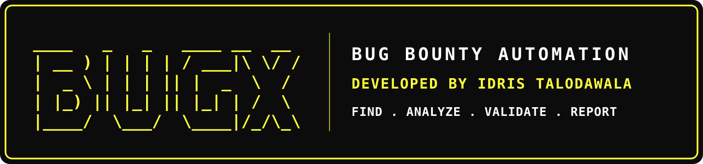

# BUGX

### Bug Bounty Automation Framework

**Developed by IDRIS4HACK**

A modular Python CLI that runs common reconnaissance, enumeration and
vulnerability-analysis tools through **one authorization and scope gate**. It also
tracks findings through safe manual validation and produces Markdown, HTML, JSON
and PDF reports.


[Installation](docs/INSTALLATION.md) ·
[Configuration](docs/CONFIGURATION.md) ·
[Usage](docs/USAGE.md) ·
[Modules](docs/MODULES.md) ·
[Architecture](docs/ARCHITECTURE.md) ·
[Troubleshooting](docs/TROUBLESHOOTING.md)

</div>

> [!WARNING]
> **For authorized security testing only.** Use BUGX only against programs and
> assets you have explicit permission to test, and follow each program's rules.
> See the [Disclaimer](#disclaimer).

---

## Table of contents

- [About BUGX](#about-bugx)
- [Features](#features)
- [Architecture](#architecture)
- [Installation](#installation)
- [Quick start](#quick-start)
- [Usage guide](#usage-guide)
- [Modules](#modules)
- [Output and reports](#output-and-reports)
- [Screenshots](#screenshots)
- [Testing](#testing)
- [Troubleshooting](#troubleshooting)
- [Roadmap](#roadmap)
- [Contributing](#contributing) · [Security](#security) · [License](#license) · [Disclaimer](#disclaimer)

---

## About BUGX

Bug bounty work means running dozens of tools, such as subdomain finders, HTTP
probes, crawlers, fuzzers and scanners. Each one has its own flags and output
format, and **none of them know the program's scope**. A single typo or an
over-eager wildcard can send traffic to an asset you are not allowed to touch.

BUGX wraps those tools in one interactive workflow so that:

- **every target passes a fail-closed Scope Engine** before any tool runs.
  Exclusions always win, wildcards apply only when configured, and anything
  unrecognised is *unverified* and never tested;
- **per-program request rules** (a required research header, a custom
  User-Agent, rate limit, concurrency, "automated scanners allowed?") are
  applied to every tool. Tools that cannot honour a required header are blocked;
- **every discovered asset is classified** (*in scope / out of scope /
  unverified*), and only in-scope assets are offered to later tools;
- **scanner output is never trusted automatically.** Every finding starts as
  *Needs Review* and becomes *Validated* only through manual validation;
- **every run is stored as JSON** and can be turned into a report at any time.

**Who it is for:** bug bounty hunters, penetration testers, and people learning
web security who want a repeatable, scope-safe workflow on top of standard
open-source tooling.

**Design in one line:** a Typer + Rich CLI. A `ToolAdapter` per external tool runs
on a shared execution engine (`core/adapters.py`) that enforces session
authorization, OS support, tool detection, request policy, confirmation and
scope on every run. Adding a tool means adding one adapter class and one
registry line.

---

## Features

Everything below is **implemented** in v1.2.0 unless marked otherwise.

### Platform selection
- HackerOne, Bugcrowd, Intigriti, YesWeHack, and Custom / private programs.

### Program configuration
- Select a saved program profile or configure a new one interactively.
- Profiles are YAML files (`config/programs/<platform>/<name>.yaml`). New
  profiles never overwrite existing files.
- ⚠️ *Partial:* interactive creation takes **one** in-scope asset. Extra assets,
  exclusions and request rules are added by editing the YAML
  ([Configuration](docs/CONFIGURATION.md)).

### Scope and authorization validation
- Scope Engine with exact domains, `*.wildcard` domains (subdomains only, not the
  apex), and URL assets that match scheme, host, port and path.
- Hosts are IDNA-normalised. IP addresses, userinfo (`a@b`), dot-segments and
  bad ports are rejected.
- The session requires typed `YES` confirmations, and the target is validated
  before the Control Center opens.
- `bugx scope-check TARGET PROFILE` for one-off checks.

### Reconnaissance: 10 tools
Subfinder, Amass, dnsx, httpx (ProjectDiscovery), Nmap, Naabu, Katana, WhatWeb,
tlsx, Cloudlist.

### Enumeration: 10 tools + 3 built-ins
FFUF, Feroxbuster, Dirsearch, Arjun, ParamSpider, Kiterunner, LinkFinder,
SecretFinder, Hakrawler, GoWitness, **plus** an endpoint inventory, a scoped
JavaScript collector and Playwright browser inspection.

### Vulnerability analysis: 10 tools
Nuclei, OWASP ZAP (baseline), Nikto, testssl.sh, Dalfox, SQLmap (detection
only), Wapiti, Retire.js, Trivy, Semgrep. Every network scanner requires a typed
`YES` per run and is blocked when the profile forbids automated scanning.

### Safe validation
- Per-finding detail, scope re-check and category-specific safe manual steps.
- Single-GET replay (scope-checked, confirmation required).
- Status workflow: *Needs Review → Potential → Validated / False Positive / Not
  Reproducible*. *Validated* requires a note or evidence.
- Reproduction steps, impact and CVSS vector + score.

### Report generation
- Markdown, HTML (autoescaped), JSON and PDF (PDF needs a local
  Chromium/Chrome/Edge).
- Full report or validated findings only. False positives are excluded.

### Results management
- Append-only JSON scan records, a deduplicated findings index, validation
  history, raw evidence per scan, scan history and a log file.

### Browser automation (optional)
- Read-only page inspection through the Playwright MCP server: title, final URL,
  classified links, form controls, console errors and a screenshot. It never
  fills or submits forms and never runs custom JavaScript.

### System health
- `bugx doctor`: Python and dependencies, every tool's status and version,
  config validity, output permissions, Playwright MCP and browser.

> **Verification status.** All 30 adapters are covered by unit tests with sample
> output. Adapters for httpx, Katana, WhatWeb, Nmap, FFUF, Feroxbuster, Nuclei,
> SQLmap and the Playwright MCP integration have also been **run end to end
> against real binaries** (localhost mock target). The rest were built from each
> tool's documentation and should be checked once after you install the tool.
> See [Modules](docs/MODULES.md#verification-status).

---

## Architecture

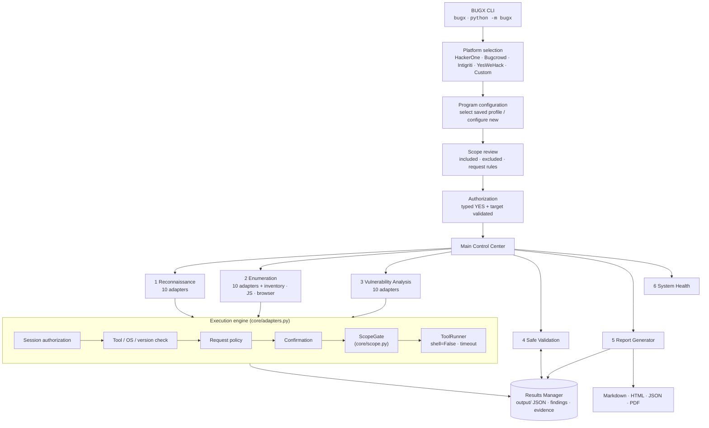

Full details: [docs/ARCHITECTURE.md](docs/ARCHITECTURE.md).

---

## Installation

**Requirements:** Python **3.10+**, Git. External security tools are optional,
and each module works with whatever is installed.

### Kali Linux / Debian / Ubuntu

```bash
sudo apt update && sudo apt install -y git python3 python3-venv python3-pip
git clone https://github.com/Idrisb53/BUGX.git
cd BUGX
python3 -m venv .venv
source .venv/bin/activate
pip install -e .                 # core
pip install -e ".[browser,dev]"  # optional: Playwright MCP client + pytest/ruff
bugx doctor
```

### Windows (PowerShell)

```powershell
git clone https://github.com/Idrisb53/BUGX.git
cd BUGX
py -3 -m venv .venv
.\.venv\Scripts\Activate.ps1
pip install -e ".[browser,dev]"
bugx doctor
```

> Windows support is partial: Naabu, WhatWeb, testssl.sh and Kiterunner are
> Linux/macOS only (BUGX marks them *Unsupported OS*). WSL is recommended for
> the full toolset.

External tools, Playwright MCP and PDF setup: **[docs/INSTALLATION.md](docs/INSTALLATION.md)**.

---

## Quick start

```bash
source .venv/bin/activate

bugx doctor                                                     # what is installed / missing
bugx scope-check www.example.com docs/examples/example-profile.yaml
bugx                                                            # interactive workflow
```

`bugx`, `python -m bugx` and `python -m bugx.cli` all start the same interactive
workflow.

### Commands

| Command | Purpose |
|---|---|
| `bugx` | Interactive workflow |
| `bugx doctor` | System health and tool inventory |
| `bugx programs` | List saved program profiles |
| `bugx scope-check TARGET PROFILE` | Is a host/URL authorized and in scope? |
| `bugx recon DOMAIN PROFILE` | Passive Subfinder recon (non-interactive) |
| `bugx history PROFILE [--limit N]` | Saved scan history |
| `bugx report PROFILE [--formats markdown,html,json,pdf] [--validated-only]` | Report from saved results |
| `bugx version` · `bugx about-command` | Version / about |

---

## Usage guide

1. **Launch** with `bugx`. The yellow-and-white banner appears.
2. **Select a platform** (1–5).
3. **Select a saved program profile** or **configure a new one**: program name,
   target URL, policy URL and one in-scope asset. You confirm *policy reviewed*
   and *authorized* with `YES`.
4. **Configure target and policy.** Add extra assets, exclusions and request
   rules (`policy:`) in the profile YAML ([Configuration](docs/CONFIGURATION.md)).
5. **Review the scope.** BUGX shows the INCLUDED / EXCLUDED assets and the
   request rules.
6. **Confirm authorization** for the session by typing `YES`.
7. **Validate the target.** It must be *in scope*, or BUGX stops after 3 attempts.
8. **Open the Control Center** and pick a module.
9. **Run a tool.** BUGX shows its install status, lets you choose targets, shows a
   **SCOPE REVIEW** table (blocked targets are never run), asks for
   confirmation, runs the tool, then shows a result summary with the saved JSON
   path.
10. **Review results** in Safe Validation and change finding statuses.
11. **Generate a report** in the Report Generator (or with `bugx report PROFILE`).

Typical order: Subfinder → dnsx → httpx → Katana → FFUF / Feroxbuster / Arjun →
Endpoint inventory → Collect JavaScript → Nuclei / Retire.js → Dalfox / SQLmap on
parameter URLs → Safe Validation → Report.

Full walkthrough with terminal output: **[docs/USAGE.md](docs/USAGE.md)**.

---

## Modules

| Module | Purpose | Tools | Safety highlights |
|---|---|---|---|
| **Reconnaissance** | Find hosts, DNS records, live HTTP services, ports, technologies | Subfinder, Amass, dnsx, httpx, Nmap, Naabu, Katana, WhatWeb, tlsx, Cloudlist | Passive where possible. Nmap uses connect scan with no NSE scripts. Katana stays on the exact host |
| **Enumeration** | Discover content, parameters, API routes, JS endpoints | FFUF, Feroxbuster, Dirsearch, Arjun, ParamSpider, Kiterunner, LinkFinder, SecretFinder, Hakrawler, GoWitness + inventory, JS collector, browser | Rate-limited, time-boxed. Secrets redacted before storage |
| **Vulnerability Analysis** | Find candidate vulnerabilities | Nuclei, ZAP baseline, Nikto, testssl.sh, Dalfox, SQLmap, Wapiti, Retire.js, Trivy, Semgrep | Typed `YES` per run. DoS / brute-force / intrusive templates excluded. SQLmap is detection-only, enforced in code |
| **Safe Validation** | Confirm or reject findings by hand | Built-in | Scope re-check, single GET only, nothing becomes *Validated* automatically |
| **Report Generator** | Produce reports from saved results | Built-in (Jinja2, headless browser for PDF) | HTML autoescaped. False positives excluded |

Per-module purpose, exact tool flags, requirements, output and limitations:
**[docs/MODULES.md](docs/MODULES.md)**.

---

## Output and reports

All results go under `output/` (override with `BUGX_OUTPUT_DIR`). This directory
is gitignored because it contains target data.

```
output/
├── recon/<program_id>/<scan_id>_<tool>.json
├── enumeration/<program_id>/<scan_id>_<tool>.json
├── vulnerability_analysis/<program_id>/<scan_id>_<tool>.json
├── validation/<program_id>/<finding_id>_<timestamp>.json
├── findings/<program_id>/findings.json         deduplicated finding index
├── evidence/<program_id>/<scan_id>/            raw tool output, screenshots
├── reports/<program_id>/bugx_report_<timestamp>.{md,html,json,pdf}
└── logs/bugx.log
```

| Format | Status | Notes |
|---|---|---|
| JSON | ✅ | Machine-readable: program, scope, attack surface, tools, findings, severity counts |
| Markdown | ✅ | Ready to adapt into a platform submission |
| HTML | ✅ | Self-contained, all scanner text autoescaped |
| PDF | ✅ | Printed from the HTML with headless Chromium/Chrome/Edge. Skipped with a reason if none is installed |

Scan files are created in exclusive mode and never overwritten. Reports can be
rebuilt at any time with `bugx report PROFILE`.

---

## Screenshots

All screenshots are **real captures** of BUGX v1.2.0 running in a terminal. They
use the reserved `example.com` example profile and, for findings, a local mock
web server on `localhost`. **No real bug bounty target was contacted.**

| | |
|---|---|
| **Startup banner**<br>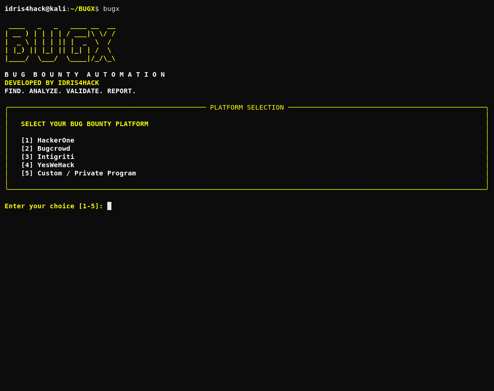 | **Platform selection**<br>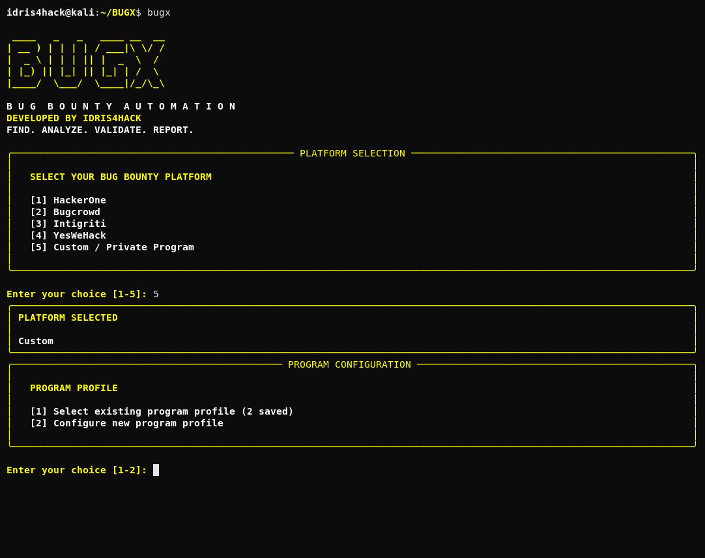 |
| **Program configuration**<br>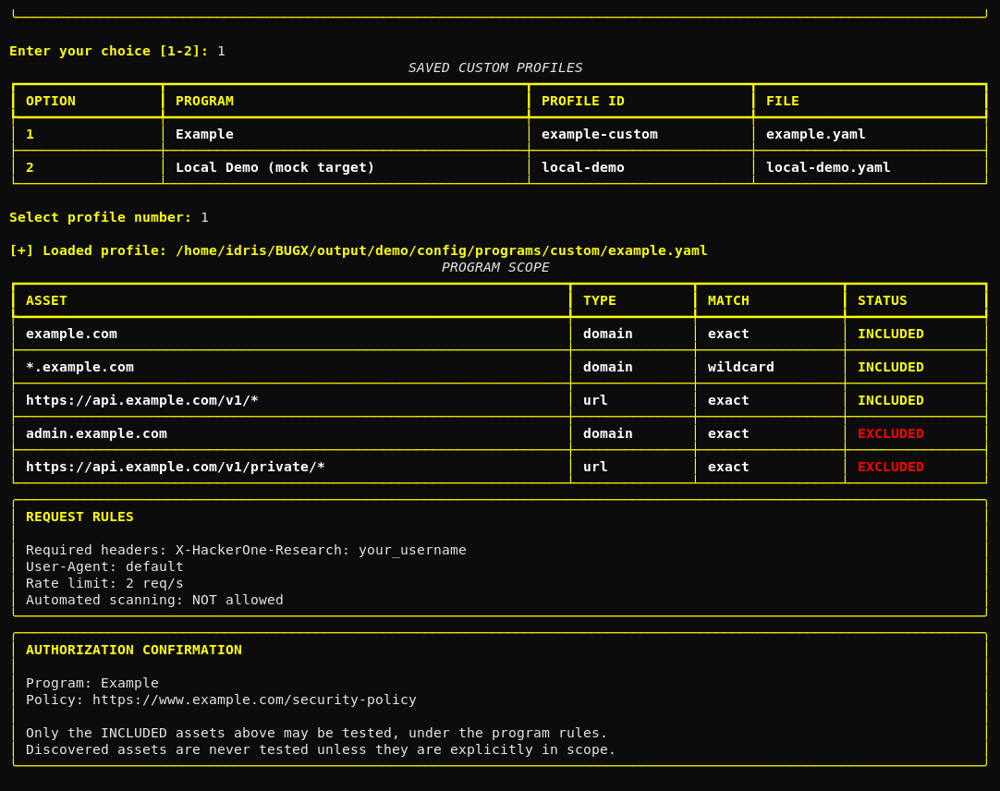 | **Scope validation**<br>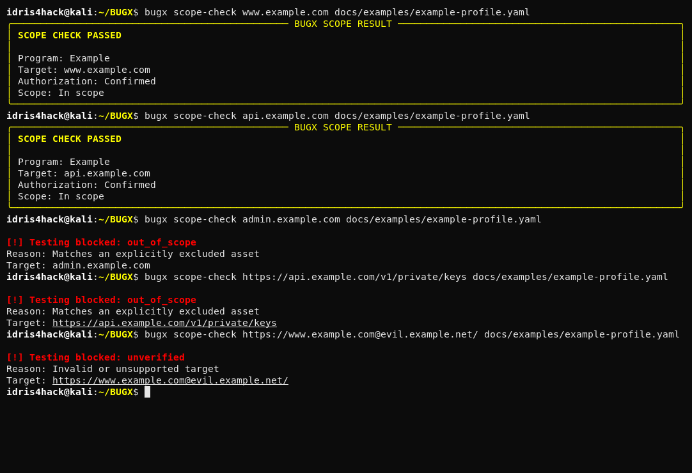 |
| **Main Control Center**<br>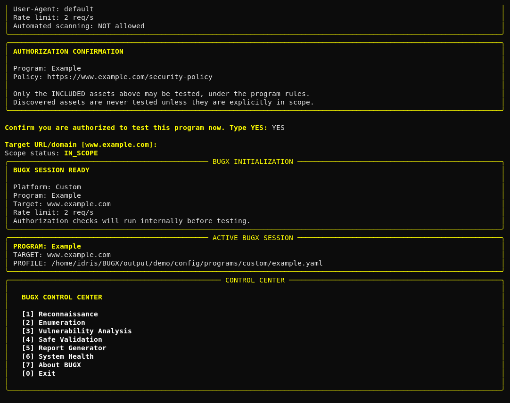 | **Reconnaissance menu**<br>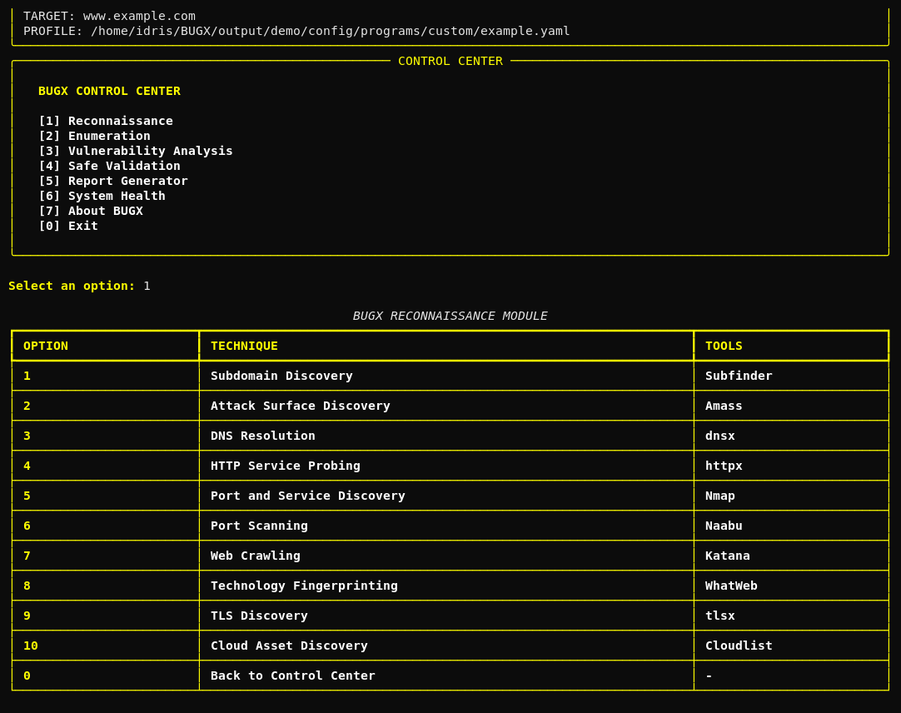 |
| **Enumeration menu**<br>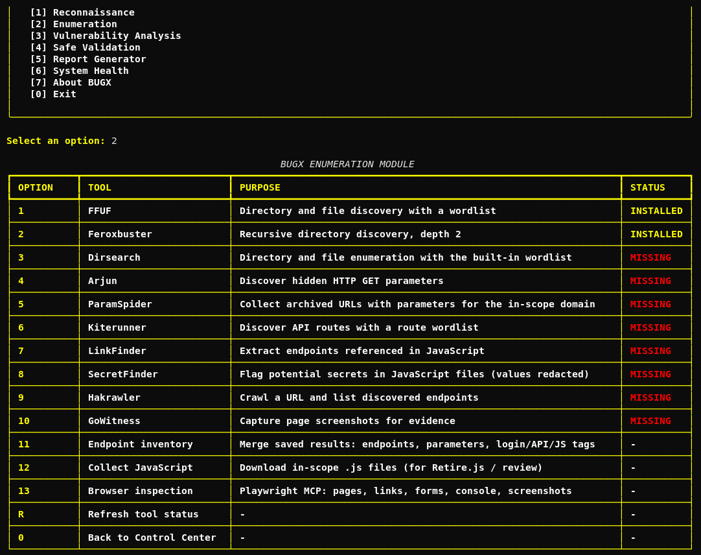 | **Vulnerability Analysis menu**<br>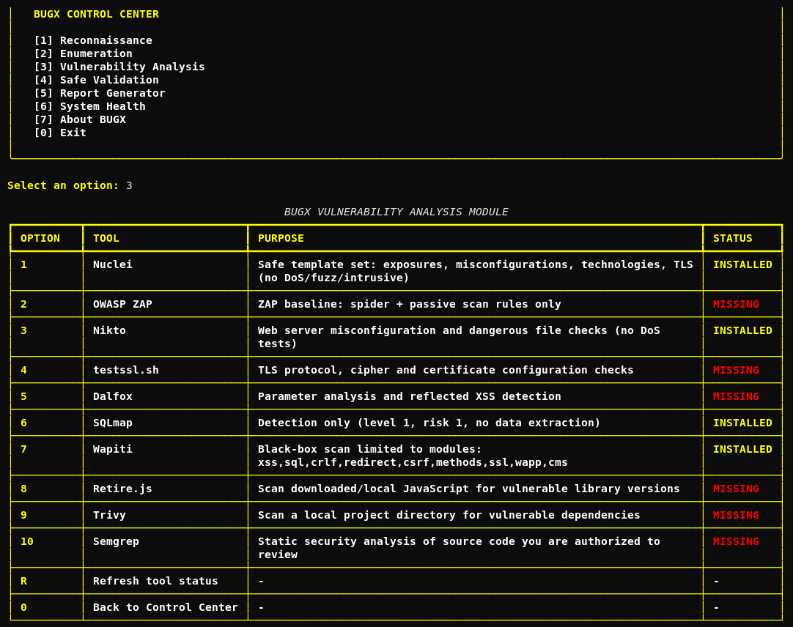 |
| **Safe Validation**<br>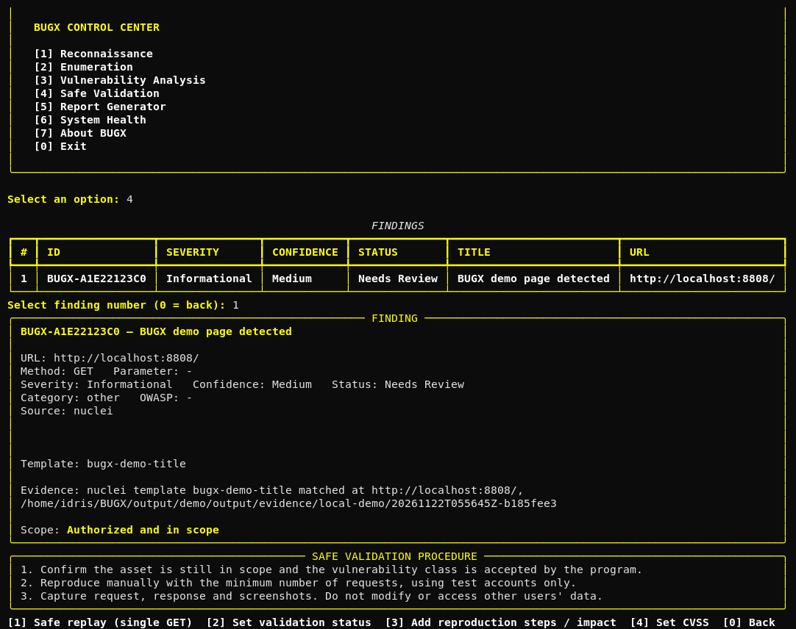 | **Report generation**<br>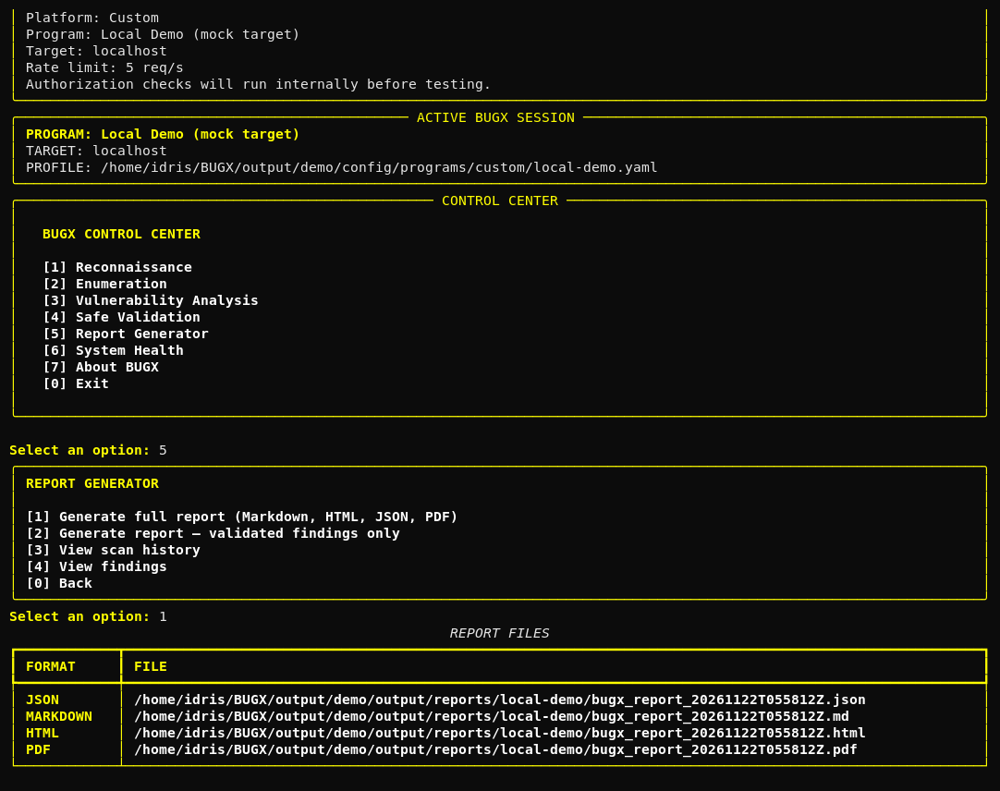 |
| **Nuclei run with scope review (localhost mock target)**<br>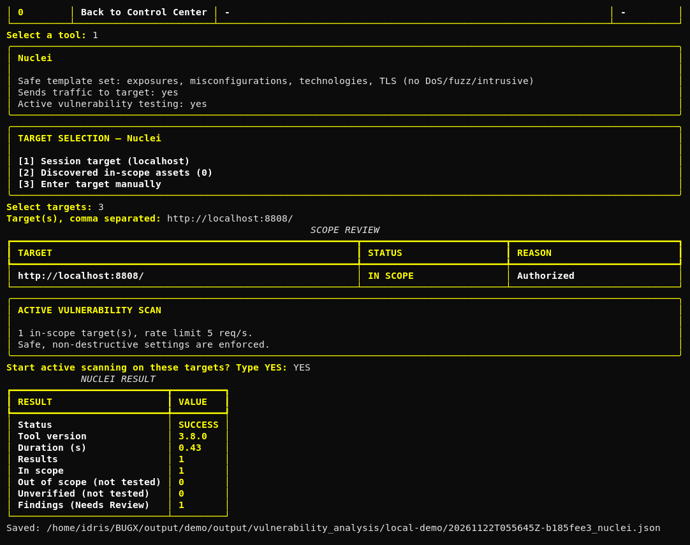 | |

Tool status columns (*Installed / Missing*) show the capture machine's toolset,
not requirements. The finding in the Safe Validation and report screenshots comes
from a one-line demo Nuclei template matched against the localhost mock server.
It is shown to demonstrate the workflow and is not a real vulnerability.

---

## Testing

```bash
pip install -e ".[dev]"
pytest -m "not e2e"   # 164 unit/integration tests, all external commands mocked (what CI runs)
pytest -m e2e         # 11 tests: real installed tools against a local mock server (localhost only)
```

End-to-end tests skip any tool that is not installed.

---

## Troubleshooting

| Problem | Fix |
|---|---|
| `bugx: command not found` | Activate the venv (`source .venv/bin/activate`) and run `pip install -e .` |
| A tool shows **MISSING** | Install it and make sure it is on `PATH`, or set `tools.<name>.path` in `config/bugx.yaml` |
| httpx shows **ERROR** on Kali | `/usr/bin/httpx` is the Python client. Install `httpx-toolkit` |
| *Programs directory not found* | Run from the repo checkout, or set `BUGX_HOME` to it |
| *Testing blocked: unverified* | The target does not match any eligible asset. Check `exact` vs. `wildcard` |
| PDF skipped | Install Chromium/Chrome/Edge |

More: **[docs/TROUBLESHOOTING.md](docs/TROUBLESHOOTING.md)**.

---

## Roadmap

Planned, **not yet implemented**:

- [ ] Interactive multi-asset / exclusion / request-rule profile editor (YAML only today)
- [ ] SQLite storage (`core/database.py` is an empty placeholder; JSON is used)
- [ ] End-to-end verification of the 22 adapters that are only unit-tested
- [ ] Full Windows verification
- [ ] Clean up the remaining `ruff` style findings

---

## Contributing

Contributions are welcome. Read **[CONTRIBUTING.md](CONTRIBUTING.md)** first. In
particular, new tool adapters must go through the shared execution engine and the
Scope Engine.

## Security

Found a vulnerability **in BUGX itself** (for example, a scope bypass)? Please
report it privately. See **[SECURITY.md](SECURITY.md)**.

## License

Released under the **[MIT License](LICENSE)**. © 2026 IDRIS4HACK.

Third-party tools driven by BUGX are separate projects under their own licenses
and are not distributed with BUGX.

## Disclaimer

BUGX is intended **only for authorized security testing**, such as bug bounty
programs whose rules permit it, penetration tests with written permission, and
your own systems and labs.

- You are solely responsible for obtaining permission and for complying with each
  program's policy, rate limits and rules, and with all applicable laws.
- BUGX's scope and policy checks reduce mistakes but **do not replace your own
  judgement**. A wrong profile means wrong scope.
- Scanner results are leads, not proof. Validate manually before reporting.
- The author accepts no liability for misuse or damage caused by this software.

<div align="center">

**BUGX** · Find. Analyze. Validate. Report. · by **IDRIS4HACK**

</div>
