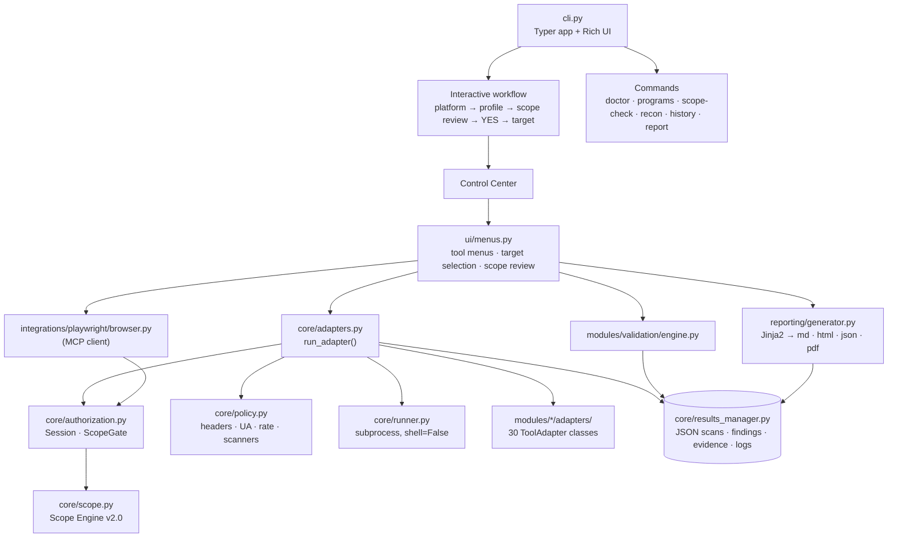

# Architecture

[← README](../README.md) · [Installation](INSTALLATION.md) · [Configuration](CONFIGURATION.md) · [Usage](USAGE.md) · [Modules](MODULES.md) · **Architecture** · [Troubleshooting](TROUBLESHOOTING.md)

---

## Overview



## Source layout

```
src/bugx/
  cli.py                     Typer/Rich CLI: interactive workflow + commands
  __main__.py                python -m bugx
  ui/menus.py                module menus (yellow/white Rich style)
  core/
    scope.py                 Scope Engine v2.0 (matching rules)
    program_manager.py       load / validate / list profiles
    profile_creator.py       create profiles (never overwrite)
    config.py                paths (BUGX_HOME, BUGX_OUTPUT_DIR), config/bugx.yaml merge
    policy.py                per-program request policy
    authorization.py         Session + ScopeGate (fail-closed wrapper over scope.py)
    adapters.py              ToolAdapter base class + run_adapter() execution engine
    runner.py                subprocess wrapper (shell=False, timeout, stdin closed)
    tool_manager.py          registry of all adapters + external tools (System Health)
    results_manager.py       JSON scans, findings index, validation records, logging
    findings.py              Finding model, severity/confidence, OWASP mapping
    health.py                System Health checks
    exceptions.py
    database.py              empty placeholder (SQLite planned; JSON is used)
  modules/
    targeting.py             default targets from in-scope results
    recon/       adapters/ (10) registry.py controller.py subdomains.py (legacy `bugx recon`)
    enumeration/ adapters/ (10) registry.py controller.py inventory.py js_collector.py
    analysis/    adapters/ (10) registry.py controller.py
    validation/  engine.py
  integrations/
    mcp/client.py            MCP SDK availability helpers
    playwright/browser.py    Playwright MCP inspection (allow-listed tools)
  reporting/
    generator.py             Markdown / HTML / JSON / PDF
    templates/report.md.j2, report.html.j2
config/
  bugx.yaml                  global settings
  programs/<platform>/*.yaml program profiles (local only, gitignored)
docs/examples/               example profile, ZAP Docker wrapper
tests/                       unit + integration (mocked); tests/e2e (real tools, localhost)
```

## Execution path of one tool

```
menu → run_tool_flow (target selection, SCOPE REVIEW table, YES)
     → run_adapter(adapter, session, targets)
         1 session.require_session_authorization()
         2 adapter.status(): OS, executable, version, binary identity, config
         3 policy: required headers supported? scanners allowed?
         4 intrusive → session.active_scanning_confirmed
         5 ScopeGate.filter_allowed(targets)    ← scope.can_test_target
         6 ToolRunner.run(argv, timeout, stdin, cwd=evidence dir)
         7 adapter.parse() → items. Dedupe. ScopeGate.classify(asset)
         8 findings → Finding(validation_status="Needs Review") → findings.json
         9 ScanRecord → output/<module>/<program>/<scan_id>_<tool>.json
```

## Adding a tool

1. Create a `ToolAdapter` subclass in `modules/<module>/adapters/<tool>.py`.
   Declare its binaries, install hints, supported OS, input kind, whether it
   sends traffic / is intrusive, and implement `build_args()` and `parse()`.
2. Add one line to that module's `registry.py`.
3. Add tests in `tests/test_<module>_adapters.py`: argument construction (with a
   policy that requires headers) and parsing of sample output.

The adapter never calls `subprocess` itself and never decides scope. The engine
does both. See [CONTRIBUTING.md](../CONTRIBUTING.md).

## Design decisions

- **One scope authority.** `authorization.py` only wraps `scope.py`. Every
  adapter, the JS collector, the validation replay and the browser use it.
- **Fail closed.** Engine errors, invalid configs and unknown statuses mean
  blocked / unverified.
- **No automatic trust.** Scanner findings start as *Needs Review*. Only a human
  sets *Validated*.
- **No shell.** All tools run with `shell=False`, closed stdin and a timeout.
  Required header values are redacted from saved commands.
- **Append-only results.** Scan files are created in exclusive mode and are
  never overwritten.
- **Small dependency footprint.** Runtime: typer, rich, pydantic, pyyaml, jinja2.
  `mcp` is optional (`[browser]`). PDF uses an installed browser instead of a PDF
  library.
- **Consistent UI.** `YELLOW = "bold bright_yellow"`, `WHITE = "bold white"`,
  yellow panel borders, `[!]` red errors, `[+]` yellow success.

---

Next: [Troubleshooting →](TROUBLESHOOTING.md)
