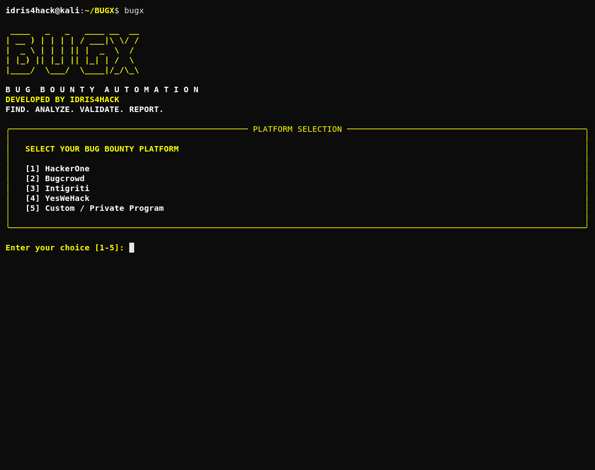
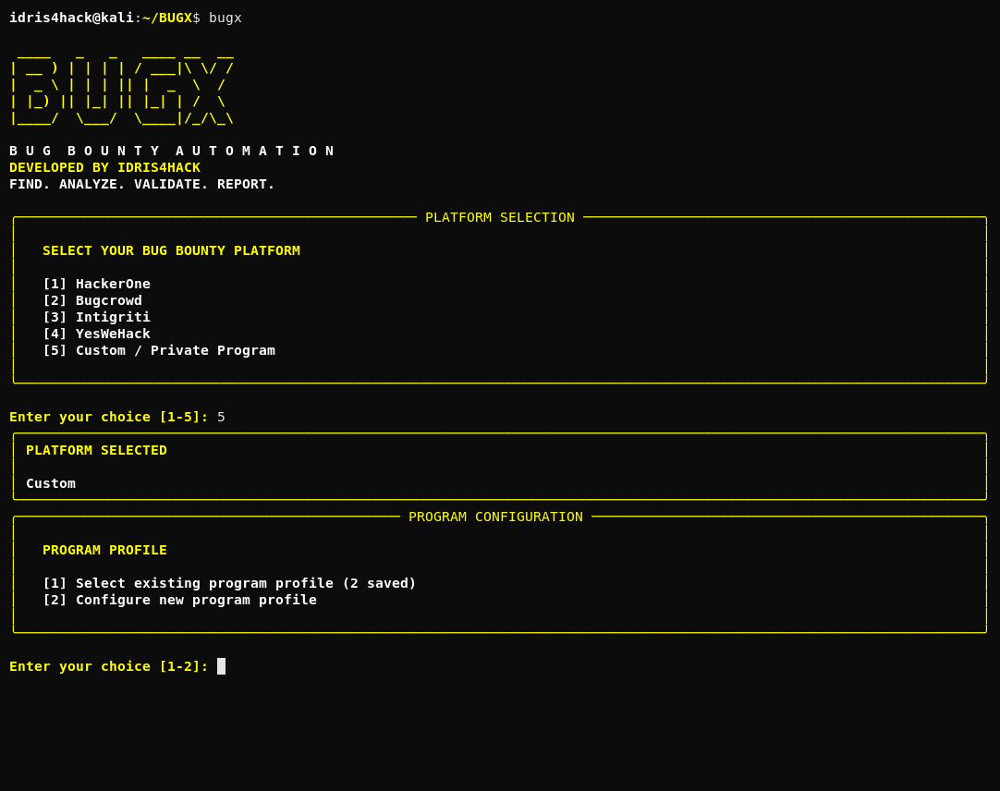
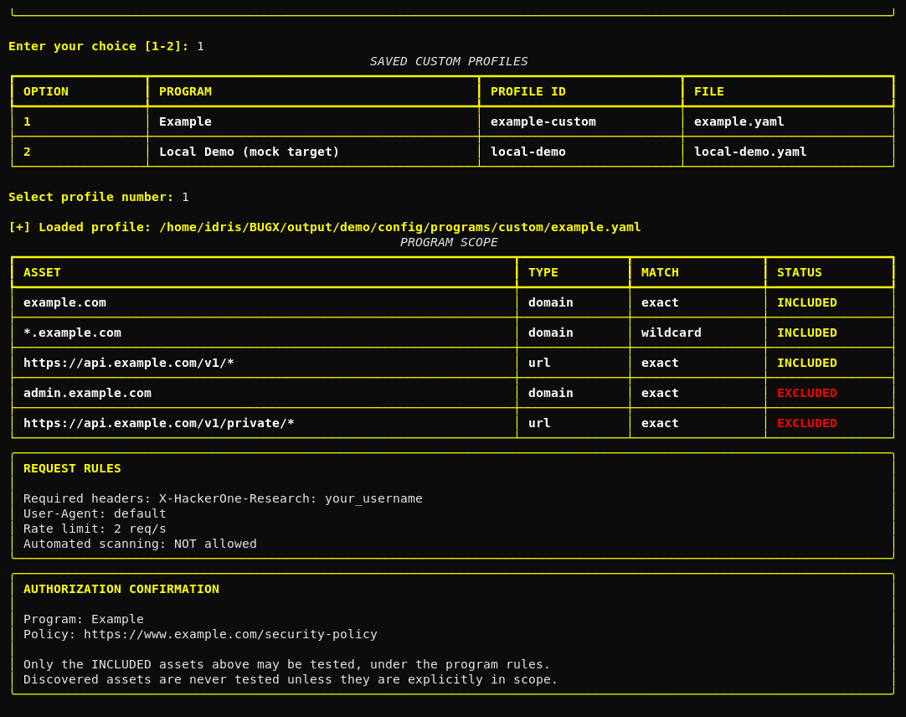
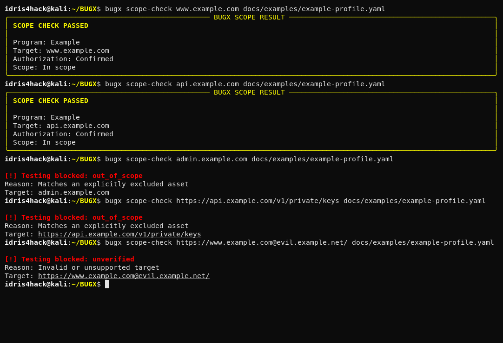
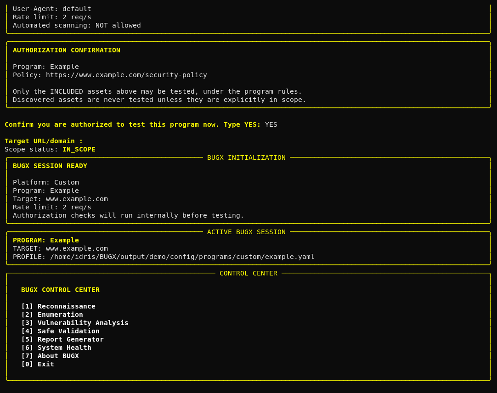
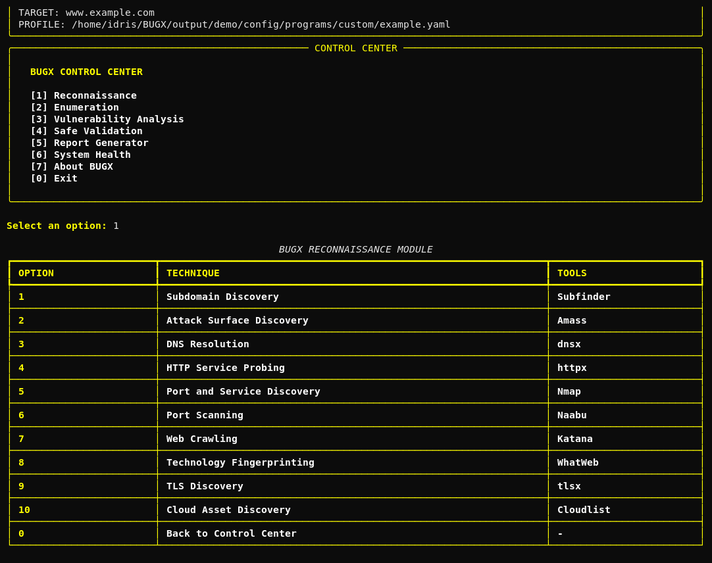
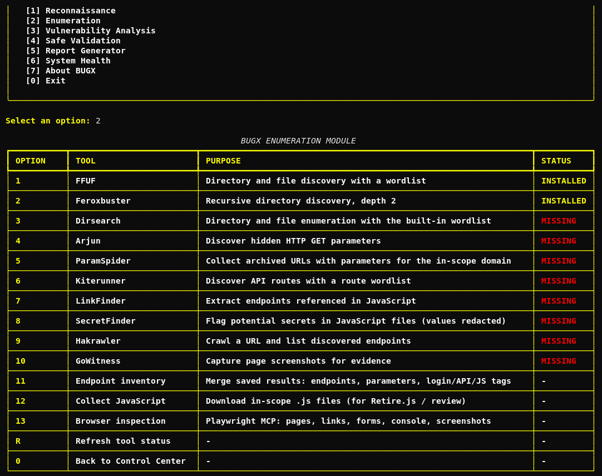
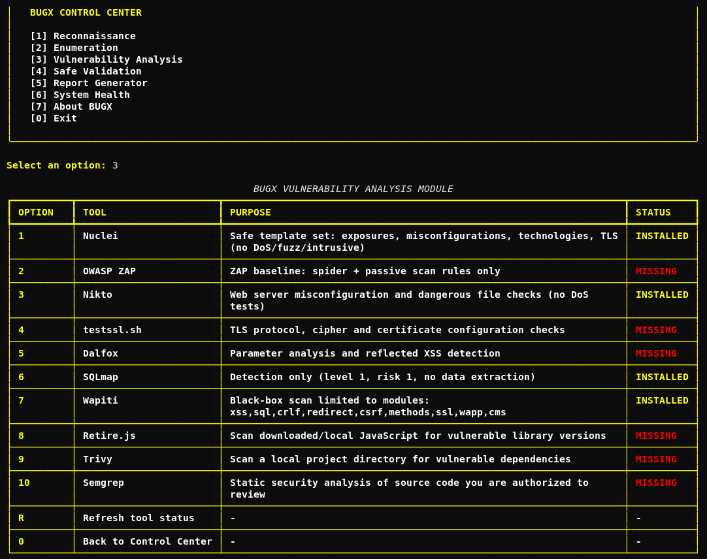
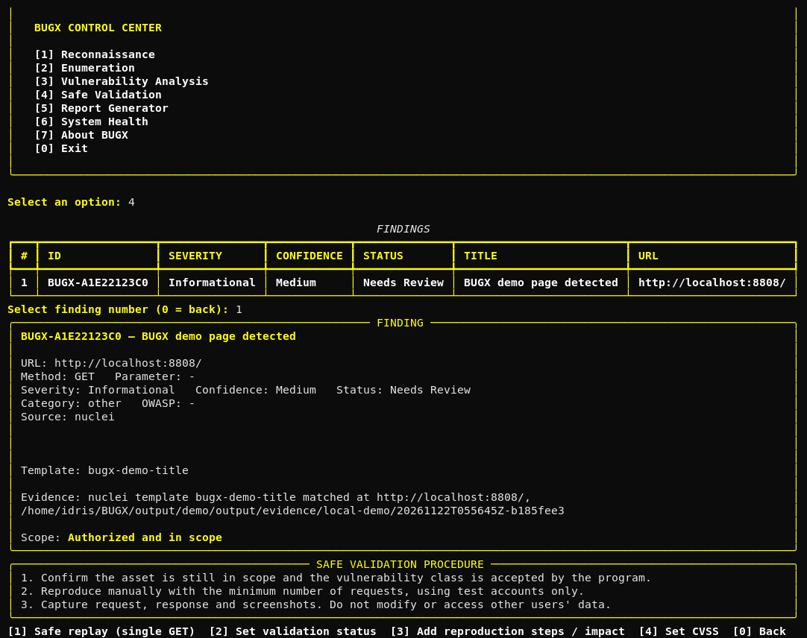
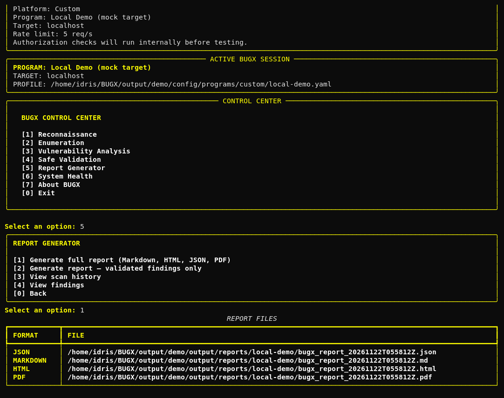

# Usage

[← README](../README.md) · [Installation](INSTALLATION.md) · [Configuration](CONFIGURATION.md) · **Usage** · [Modules](MODULES.md) · [Architecture](ARCHITECTURE.md) · [Troubleshooting](TROUBLESHOOTING.md)

---

- [1. Start BUGX](#1-start-bugx)
- [2. Select a platform](#2-select-a-platform)
- [3. Select or configure a program](#3-select-or-configure-a-program)
- [4. Scope review and authorization](#4-scope-review-and-authorization)
- [5. Control Center](#5-control-center)
- [6. Running a tool](#6-running-a-tool)
- [7. Enumeration extras](#7-enumeration-extras)
- [8. Safe Validation](#8-safe-validation)
- [9. Reports and history](#9-reports-and-history)
- [10. Non-interactive commands](#10-non-interactive-commands)

---

## 1. Start BUGX

```bash
source .venv/bin/activate
bugx                    # or: python -m bugx   /   python -m bugx.cli
```



## 2. Select a platform

Choose `1` HackerOne, `2` Bugcrowd, `3` Intigriti, `4` YesWeHack or `5` Custom /
Private Program. The platform decides which folder under `config/programs/` is
used.



## 3. Select or configure a program

- **`[1] Select existing program profile`** lists the saved profiles for that
  platform in a table. Pick one by number.
- **`[2] Configure new program profile`** asks for:
  1. program name
  2. target URL (the real in-scope site, **not** the platform's program page)
  3. policy URL
  4. one in-scope asset (`example.com`, or `*.example.com` for a wildcard)
  5. `YES` for "I reviewed the program policy"
  6. `YES` for "I am authorized to test this program"

  The YAML is written to `config/programs/<platform>/<slug>.yaml`. Existing
  files are never overwritten.

To add more assets, exclusions or request rules (required header, User-Agent,
rate limit, scanner permission), edit the profile YAML. See
[Configuration](CONFIGURATION.md#program-profiles).



## 4. Scope review and authorization

1. BUGX shows the **PROGRAM SCOPE** table (INCLUDED / EXCLUDED assets) and the
   **REQUEST RULES**.
2. Type `YES` to confirm that you are authorized for this session.
3. Enter the target. The suggestion is the profile target, if it is in scope.
   The target must be **in scope**. After 3 rejected attempts BUGX stops.



## 5. Control Center

```
[1] Reconnaissance
[2] Enumeration
[3] Vulnerability Analysis
[4] Safe Validation
[5] Report Generator
[6] System Health
[7] About BUGX
[0] Exit
```



## 6. Running a tool

Each module menu lists its tools with their status: **INSTALLED / MISSING /
ERROR / NOT CONFIGURED / UNSUPPORTED OS**. Press `R` to re-check, `0` to go back.
Selecting a tool that is not installed prints its install hint.

When you run a tool:

1. **Tool panel.** Shows its purpose, whether it sends traffic to the target, and
   whether it is active vulnerability testing.
2. **Target selection.** `[1]` session target, `[2]` discovered in-scope assets
   from earlier scans, `[3]` manual entry. Local-analysis tools (Retire.js,
   Trivy, Semgrep) ask for a path instead. Trivy and Semgrep also ask you to
   confirm that you are authorized to analyse that source.
3. **SCOPE REVIEW** table. Every target is classified. Blocked targets are listed
   with the reason and are **never executed**.
4. **Confirmation.** Type `YES` before any tool that contacts the target.
   Vulnerability scanners show an **ACTIVE VULNERABILITY SCAN** panel and need
   `YES` every run. They are blocked outright if the profile has
   `automated_scanning: false`.
5. **Result table.** Shows status, tool version, duration, result count,
   in-scope / out-of-scope / unverified counts, findings, and the saved JSON path.

Typical order:

```
Recon:        Subfinder → dnsx → httpx → Katana
Enumeration:  FFUF / Feroxbuster, Arjun → Endpoint inventory → Collect JavaScript
Analysis:     Nuclei, Retire.js (on the collected JS folder), Dalfox / SQLmap (parameter URLs)
Then:         Safe Validation → Report Generator
```

| Reconnaissance | Enumeration | Vulnerability Analysis |
|---|---|---|
|  |  |  |

## 7. Enumeration extras

| Option | What it does |
|---|---|
| **11 Endpoint inventory** | Merges saved results. Tags login, registration, password reset, API, GraphQL, JavaScript, admin, upload and parameter endpoints |
| **12 Collect JavaScript** | Downloads in-scope `.js` files (scope-checked, policy headers, rate limit, 5 MB cap per file) for Retire.js or manual review |
| **13 Browser inspection** | Playwright MCP: title, final URL, classified links, form controls, console errors, screenshot. Never fills or submits forms or runs JavaScript |

## 8. Safe Validation

Open **4 Safe Validation** and pick a finding. BUGX shows:

- the finding details and a **scope re-check** of its URL;
- a **SAFE VALIDATION PROCEDURE** with category-specific manual steps;
- actions:
  - `[1]` **Safe replay**: one GET request (scope-checked, confirmation required)
  - `[2]` **Set validation status**: *Needs Review, Potential, Validated, False
    Positive, Not Reproducible*
  - `[3]` **Add reproduction steps / impact**
  - `[4]` **Set CVSS**: vector + score

*Validated* requires a note or evidence. Every change is saved as a validation
record under `output/validation/<program_id>/`.



## 9. Reports and history

**5 Report Generator** offers:

```
[1] Generate full report (Markdown, HTML, JSON, PDF)
[2] Generate report – validated findings only
[3] View scan history
[4] View findings
```

Files are written to `output/reports/<program_id>/bugx_report_<timestamp>.{md,html,json,pdf}`.
False positives and not-reproducible findings are excluded. With no findings, the
report says *No vulnerabilities were identified*.



## 10. Non-interactive commands

Real output, using the bundled example profile (`example.com` is a reserved demo
domain):

```text
$ bugx scope-check www.example.com docs/examples/example-profile.yaml
╭───────────────────────── BUGX SCOPE RESULT ──────────────────────────╮
│ SCOPE CHECK PASSED                                                   │
│                                                                      │
│ Program: Example                                                     │
│ Target: www.example.com                                              │
│ Authorization: Confirmed                                             │
│ Scope: In scope                                                      │
╰──────────────────────────────────────────────────────────────────────╯
$ echo $?
0

$ bugx scope-check admin.example.com docs/examples/example-profile.yaml
[!] Testing blocked: out_of_scope
Reason: Matches an explicitly excluded asset
Target: admin.example.com

$ bugx scope-check https://api.example.com/v1/private/keys docs/examples/example-profile.yaml
[!] Testing blocked: out_of_scope
Reason: Matches an explicitly excluded asset
Target: https://api.example.com/v1/private/keys

$ bugx report docs/examples/example-profile.yaml --formats markdown,json
┏━━━━━━━━━━┳━━━━━━━━━━━━━━━━━━━━━━━━━━━━━━━━━━━━━━━━━━━━━━━━━━━━━━┓
┃ FORMAT   ┃ FILE                                                 ┃
┡━━━━━━━━━━╇━━━━━━━━━━━━━━━━━━━━━━━━━━━━━━━━━━━━━━━━━━━━━━━━━━━━━━┩
│ JSON     │ output/reports/example-custom/bugx_report_<ts>.json  │
│ MARKDOWN │ output/reports/example-custom/bugx_report_<ts>.md    │
└──────────┴──────────────────────────────────────────────────────┘
```

| Command | Notes |
|---|---|
| `bugx programs` | Lists every saved profile (invalid profiles are flagged, not fatal) |
| `bugx doctor` | Full system health. Same as Control Center → 6 |
| `bugx recon DOMAIN PROFILE` | Passive Subfinder recon. Writes `output/recon/<domain>/{all_subdomains,in_scope,out_of_scope,unverified}.txt`. Exit code 1 on failure |
| `bugx history PROFILE --limit 50` | Last N saved scans |
| `bugx report PROFILE --validated-only` | Only *Validated* findings |

---

Next: [Modules →](MODULES.md)
